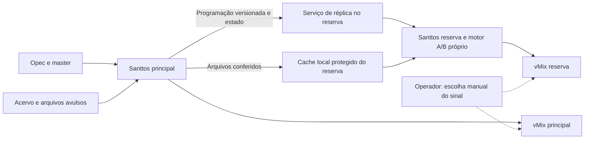

# Espelhamento do Santtos com reserva e assunção manual

Estudo de engenharia de 28/10/2026, com inspeção do código e das referências ao final. **Proposta para implementação; o espelhamento ainda não existe no produto.** Substitui o escopo mais amplo do estudo anterior para a primeira entrega.

## Objetivo definido pelo responsável

Instalar a mesma versão do Santtos em dois PCs. O principal é a origem da programação; o reserva recebe suas alterações e guarda os materiais em cache próprio. Se o principal falhar, o operador assume pelo reserva. O SRT não deve dominar o projeto: a fonte da instalação pode ser reconectada depois da liberação da sessão, com tempo de recuperação a medir.

O reserva deve continuar sem o principal e sem a unidade T:, desde que os materiais necessários já estejam conferidos localmente. Arquivos ainda não transferidos não podem receber a indicação de prontos. Nenhum sistema consegue garantir a cópia de um arquivo que entrou na programação imediatamente antes de o único PC que o possui desligar.

Não se propõe copiar continuamente a pasta do aplicativo, compartilhar o banco em uso ou transformar o reserva em receptor do vídeo do principal. Instalação e atualização dos dois Santtos são operações separadas do espelhamento dos dados. Não haverá troca automática de autoridade nesta versão.

## Decisão recomendada

Implementar um serviço de réplica integrado ao Santtos, com transferência e hash fora do processo de reprodução. Cada PC mantém motor A/B, banco e armazenamento locais. O reserva acompanha a reprodução em paralelo quando possível, sem se declarar automaticamente a máquina no ar. O operador continua escolhendo o sinal que chega à TV no equipamento ou destino existente.

O desenho não pressupõe que exista um terceiro computador ou um novo seletor. A troca final entre os dois vMix deve ser ensaiada na instalação, mas não impede desenvolver a réplica de programação e cache agora. Replicar cenas, presets e comandos do vMix fica fora desta entrega.

## O que o código já oferece e o que falta

| Base existente | Limite constatado | Mudança necessária |
|---|---|---|
| Motor PROGRAM em processo separado e decks A/B | Autonomia dentro de um PC, sem acompanhamento entre PCs | Serviço de réplica independente do renderer e do decoder |
| `database.js`: `publishTimeline` espera a gravação antes de ativar | Os materiais precisam existir no catálogo local; aplicar um roteiro gera novos IDs de ocorrência com `Date.now()` | Importação específica da réplica, preservando os IDs publicados pelo principal e resolvendo os arquivos locais |
| QC em `quality-worker.js`: SHA-256, streams, loudness e política de recuperação | Fingerprint inclui tamanho/mtime/inode da máquina; não pode ser copiado como prova local | Conferir bytes no reserva e criar vínculo local; preservar análise somente sob condições compatíveis |
| `ServerMediaManager`: cópia `.partial`, conferência de tamanho e alteração da origem | Índice e nome do cache dependem do caminho, não do conteúdo; não confirma SHA-256 na cópia | Armazenamento de réplica por hash e versão, com manifesto durável |
| Cache existente tem limite e remove os mais antigos | Protege trabalho em curso e fonte ativa, mas não toda a programação futura; admite reprodução direta da origem | Fixar arquivos necessários e usar exclusivamente o local para ocorrências replicadas |
| Checkpoint local periódico de 1 segundo | Recupera uma instalação, sem revisão de programação, histórico de comandos ou offset de relógio entre PCs | Estado de réplica e journal próprios; não copiar `playout-recovery.json` entre PCs |
| Controlador web Opec autenticado por PIN/sessão | Não é um canal persistente de confiança entre máquinas e não replica a fila efetiva | Pareamento dedicado, conexão autenticada e protocolo específico |

O mesmo caminho ou nome não prova que os materiais são iguais. A mesma sequência de números da playlist não identifica uma ocorrência. E uma conexão aberta não prova que o reserva tem o arquivo completo nem que está reproduzindo a posição correta.

## Duas versões distintas: rascunho e fila aplicada

1. **Programação em edição:** sincronizar os roteiros salvos da Opec/master e iniciar a cópia dos materiais assim que entrarem neles. Alterações ainda não salvas não são prometidas como recuperáveis. Um roteiro poderá estar salvo no reserva com arquivos pendentes.
2. **Fila aplicada ao Playout:** publicar uma revisão imutável da fila que realmente ficou ativa no principal, incluindo o item preservado no ar. Não fazer B reaplicar o roteiro por data: as regras de horário, tolerância e preservação do item atual poderiam produzir outra fila.

Também observar inserções diretas no Playout, arquivos avulsos do Explorador, substituições, limpeza da playlist e alterações de IN/OUT/loop/FRZ/logo/GC. Nada disso pode depender de estar cadastrado na biblioteca. Os arquivos temporários de programação permanecem fora da biblioteca visível do reserva.

Histórico já encerrado pode espelhar somente os documentos e relatórios: não baixar automaticamente anos de acervo por estarem referenciados no calendário passado. A proteção de mídia vale para a fila vigente e para as programações futuras incluídas na operação. Ao importar um dia antigo para uma nova programação, seus materiais voltam a entrar na fila de preparação.

Salvar um rascunho no principal não deve trocar a fila ativa do reserva. Ao receber uma revisão aplicada incompleta, B mantém a última revisão utilizável e informa qual revisão está pendente. A conclusão de uma cópia, por si só, não autoriza iniciar outra programação.

## Manifesto de programação e identidade dos materiais

Propor um documento com versão de protocolo, `pairId`, `authorityId`, `runId`, `revision`, checksum do manifesto, revisão anterior, data/instantes absolutos e ocorrências ordenadas. Cada ocorrência conserva seu ID, referência ao hash do material, IN/OUT, modo de duração/relógio, repetição, FRZ, grafismos, identificação e observação.

Materiais possuem SHA-256, tamanho, nome exibido, tipo/extensão, streams selecionados, metadados e evidência de QC. Logos e demais arquivos realmente usados pelo grafismo também entram no manifesto. Referências a URLs/segredos são protegidas pelo canal e omitidas dos logs. Destinos de saída, IPs, nomes NDI/OMT, dispositivos e pastas de cache continuam próprios de cada PC; copiar esses valores indiscriminadamente pode criar conflito.

No reserva, o caminho é gerado internamente, por exemplo `replica-cache/<sha256>.mkv`. Não aceitar do outro PC um caminho de destino arbitrário. Ocorrências diferentes do mesmo arquivo reutilizam os mesmos bytes. Mudou o arquivo mantendo o nome? É um novo hash: manter a versão antiga para ocorrências que já a referenciam e transferir a nova para uma nova revisão, sem alterar o material no ar.

SHA-256 identifica bytes e detecta erro de cópia; a identidade do emissor é garantida pelo pareamento autenticado, não pelo hash sozinho.

## Cache integral, independente e protegido

“Tudo que vai para a programação vai para o cache” aplica-se aos arquivos, inclusive os que estão no C: do principal e os avulsos. O reserva não reproduz pelo caminho `T:` ou `C:` do outro PC. Inputs Web são referências ao vivo e não equivalem a arquivos armazenáveis.

Fluxo de um material:

1. Principal confirma a versão da origem e a análise necessária. Pode servir sua cópia local já conferida, desde que o hash corresponda à versão publicada.
2. Reserva solicita somente os hashes ausentes. Prioridade: item atual, próximos itens, restante da fila aplicada, depois roteiros futuros salvos. Cada ativo recebe seu hash antes de ser anunciado como pronto.
3. Transferir para `.partial` em disco local, com limite de concorrência e velocidade. Recomeçar do trecho confirmado depois de uma queda, sempre verificando identidade/tamanho da versão; não misturar dois conteúdos sob o mesmo nome.
4. Conferir tamanho e SHA-256 completo no destino. Fechar/gravar o arquivo, promover por rename dentro do mesmo volume e persistir o índice/manifesto antes de confirmar disponibilidade. Falha de disco mantém a versão anterior; `.partial` nunca é reproduzido.
5. Resolver os metadados para o caminho local. Só reutilizar QC/loudness/recovery do principal se os bytes, streams, versão da política e compatibilidade do runtime forem conferidos; o fingerprint passa a ser local. Se houver incompatibilidade, analisar localmente antes de marcar pronto.

Não efetuar decode completo desnecessário dos mesmos bytes em ambos os PCs enquanto o programa está no ar; também não importar um status “aprovado” sem verificar o material que chegou. Hash/transferência ficam fora do motor e com leitura limitada para não competir com a reprodução.

Fixar por referência durável: revisão ativa, revisão em preparo, material aberto pelo decoder e roteiros futuros mantidos para contingência. Manter a revisão anterior até a nova estar utilizável. A remoção de um item da programação não deve apagar um arquivo que ainda tenha outra referência. Atualizar referências de forma transacional ou recuperável por geração de manifesto.

Ao atingir o limite, limpar apenas os arquivos sem referência, começando pelos mais antigos. Se os materiais protegidos não couberem, sinalizar “espaço insuficiente” e suspender a cópia; não apagar material necessário nem recorrer silenciosamente ao principal. A garantia de guardar tudo exige espaço suficiente. Consultar também espaço livre real, com reserva para banco, relatórios, temporários e sistema operacional.

O cache de réplica pode reutilizar utilitários do cache atual, mas deve ter índice separado inicialmente: alterar globalmente o cache existente e o fluxo de reprodução de uma vez ampliaria o risco. Um mesmo arquivo físico só poderá ser compartilhado entre caches se houver contagem de referências que impeça exclusão indevida; isso não é requisito inicial.

## Acompanhamento da execução

B deve receber o estado autoritativo do motor, não o cronômetro desenhado na interface. Usar IDs de sessão/ocorrência e sequência de comandos separados da geração local dos decoders.

Proposta inicial de transporte: eventos de play/pause/stop/avanço/seek/loop/FRZ/grafismos com sequência e confirmação; snapshots pequenos de execução a cada 250 ms; estado de conexão a cada segundo. Perder alguns pacotes não autoriza trocar o item por suposição. Esses intervalos são parâmetros iniciais de implementação, não uma garantia de tempo de recuperação.

Snapshots incluem revisão, ocorrência, estado real, posição no conteúdo, IN/OUT, contador de loop e última sequência aplicada. Repetições de mensagem não repetem um avanço. Lacuna na sequência exige reconciliação por snapshot e manifesto: não reproduzir cegamente comandos antigos de uma fila que já mudou. Persistir confirmação dos comandos que alteram estado para lidar com reinício.

Cada motor conserva áudio e vídeo no mesmo domínio de tempo local. Medir diferença de relógios e RTT por trocas de amostras; não comparar diretamente valores de `performance.now()` de processos/PCs diferentes. Relógio de calendário serve ao agendamento, não ao ritmo das amostras. Usar a fonte de tempo da instalação como apoio e descartar amostras de rede excessivamente atrasadas.

O reserva prepara o próximo item e acompanha as transições com seu próprio motor A/B. Pequenos desvios são observados; uma divergência persistente é corrigida somente no reserva fora do ar, por entrada sincronizada em posição segura, preferencialmente na fronteira entre itens. Não fazer seek a cada snapshot nem corrigir áudio e vídeo separadamente. Não alterar a velocidade do principal para perseguir B.

Como alvo inicial de bancada, avaliar diferença de posição de até 250 ms depois de estabilizar e medir o pior caso. Isso é um critério proposto, ainda não medido, e não promete uma comutação sem quadro/amostra repetidos ou perdidos. Conteúdo na mesma posição também não garante mesma latência nos dois vMix.

Se B ainda não tem o material atual, não deve iniciar um arquivo incompleto, marcar o item como erro editorial nem pular sem informar. Estado explícito: “reserva sem material atual”. Ele conserva a última programação completa e permite ao operador avaliar a alternativa disponível.

## Perda do principal e assunção manual

| Situação | Comportamento proposto |
|---|---|
| Cai apenas o link entre os PCs | B continua sua fila local a partir do último estado aceito; mostra perda de acompanhamento. Não toma autoridade automaticamente |
| Principal desliga durante arquivo já sincronizado | B continua reproduzindo; operador escolhe seu sinal e aciona “Assumir operação” para torná-lo independente dos comandos de A |
| Reserva estava parado | Assunção oferece retomar a ocorrência/posição conhecida, levando em conta idade do último estado e modo play/pause/FRZ. Não reiniciar a lista no item 1 |
| Principal volta depois da assunção | Não empurra a programação antiga para B. Requer reintegração explícita e passa a reserva depois da conferência |
| Operador quer voltar para A | Preparar A com a programação e posição de B, conferir e fazer nova troca manual |

“Assumir operação” muda a autoridade local da réplica; não é prova de que o sinal de B foi selecionado para a TV. O momento da seleção final precisa de registro próprio/declaração do operador se não houver integração com o destino. Também não mata remotamente o PC isolado nem garante exclusividade de uma chave RTMP durante uma partição.

Após a assunção, B rejeita comandos da sessão antiga. A reconexão usa identidade, revisão e histórico de autoridade; divergências após edição nos dois lados exigem escolha explícita de qual programação prevalece. Não implementar “o último arquivo salvo vence”. Eleição automática e consenso entre dois nós ficam fora do escopo.

## Inputs Web e SRT

Espelhar configuração, duração/OUT absoluto e referência da ocorrência, mantendo segredos protegidos. Quando permitido, B abre a origem diretamente; a falta de A não deve cortar uma retransmissão necessária ao reserva.

Para a fonte SRT da instalação que só permite uma sessão, B fica preparado para conectar quando o operador assumir e a sessão anterior for liberada. Ter configuração pronta não significa ter vídeo pronto. Testar também casos em que o emissor demora a encerrar uma sessão morta. A conexão do reserva executa somente o restante da janela editorial; o tempo de conexão não reinicia a duração total nem prolonga o OUT absoluto.

Inputs sem limite de conexões podem ser recebidos em paralelo. Ajustes locais de endereço/porta ficam em perfil por máquina quando necessários. Se um vivo estiver offline, o estado explica essa limitação sem declarar toda a réplica de arquivos inutilizável.

## Pareamento, controle de carga e operação

Na configuração, escolher principal/reserva e informar o endereço do outro PC. Usar confirmação inicial de identidade do certificado, credenciais próprias do par e canal TLS autenticado com identidade fixada; depois persistir o pareamento sem exigir PIN a cada reinício. Não reaproveitar o PIN temporário da Opec como senha permanente de réplica. Permitir revogar o outro PC.

Preferir HTTPS com streaming e Range/ETag para arquivos e canal persistente autenticado para eventos. Uma porta dedicada configurável evita misturar sessão de browser e permissões entre máquinas; `8788` seria apenas um padrão proposto, sujeito à disponibilidade. Endpoints aceitam hashes/IDs anunciados pelo manifesto, não leitura arbitrária do disco. Limitar tamanhos, concorrência, filas, tentativas e comandos aceitos; mascarar tokens de Input Web em diagnóstico.

Começar com uma transferência por vez e hash em worker/processo de prioridade reduzida. Limitar banda e observar carga/intervalos de quadros. Pausar/reduzir transferências em pressão de disco/CPU/memória antes de prejudicar o PROGRAM. Reconexão usa atraso progressivo com variação, sem loop de reconexão ou fila de snapshots sem limite. Telemetria de execução não exige gravação em disco quatro vezes por segundo; persistir checkpoints e mudanças relevantes em frequência controlada.

Estados úteis, separados: conexão, revisão recebida, materiais disponíveis, acompanhamento da execução e autoridade. “Conectado” não é sinônimo de “pronto”. Mostrar versão e quantidade/bytes pendentes; arquivo atual/seguinte e posição; última comunicação; motivo de divergência. A interface pode resumir em “Pronto”, “Sincronizando”, “Sem conexão” ou “Incompleto”, mantendo os detalhes consultáveis.

## Espaço e prazo para a primeira cópia

Dimensionar por bytes dos arquivos únicos referenciados, não pela duração somada dos blocos. Dividir um filme em seis blocos não exige seis cópias. Repetir o mesmo comercial também não. Reservar espaço para versões anterior e nova quando houver substituição.

Exemplo aproximado, considerando 24 horas de arquivos distintos e bitrate total médio:

| Média | Volume decimal em 24 h |
|---|---|
| 10 Mb/s | 108 GB |
| 20 Mb/s | 216 GB |
| 30 Mb/s | 324 GB |

O padrão atual de 80 GiB de cache não pode ser tratado como suficiente para qualquer grade diária. A 20 Mb/s, comporta aproximadamente 9 h 33 min de materiais distintos, antes de margens/temporários. A aplicação precisa calcular os bytes necessários antes da primeira preparação.

Copiar 300 GB por rede de 1 Gb/s leva pelo menos 40 minutos no limite teórico; a 80 MB/s efetivos, cerca de 62,5 minutos, além das etapas de validação e contenção de carga. A primeira sincronização deve ocorrer antes do uso como reserva. Alterações seguintes transferem somente os conteúdos ausentes.

## Alternativas consideradas

| Alternativa | Avaliação para esta entrega |
|---|---|
| Pasta compartilhada/mesmo T: em ambos | Útil como origem; não entrega autonomia nem o estado do motor |
| Copiar a pasta de banco em uso | Rejeitada: versões misturadas, caminhos locais e checkpoints inconsistentes |
| Syncthing para pasta de mídia preparada | Transferência robusta por blocos e hash, mas não entende publicação editorial, posição de reprodução, cache protegido ou assunção. Exigiria serviço/configuração extra e integração de disponibilidade |
| Serviço interno com manifesto e transferência retomável | Recomendado: incorpora a disponibilidade real à programação e evita duplicar a biblioteca toda. Exige testes específicos de transferência, autenticação e recuperação |

As técnicas de temporários, hash e identidade autenticada foram confirmadas na documentação do Syncthing; não se propõe copiar seu código nem embarcar um novo sincronizador nesta etapa. Não implementar transferência diferencial sofisticada inicialmente: reutilizar arquivos inteiros já conferidos e retomar parciais é suficiente para o primeiro ciclo.

## Ordem de implementação e aceitação

1. **Dados e cache:** manifesto versionado, identidade por conteúdo, cadastro local dos avulsos, cache protegido, verificação de QC local e retomada de cópia. Demonstrar uma programação completa executando no reserva com A desligado e T: desconectado.
2. **Pareamento e espelhamento editorial:** canal autenticado, roteiros salvos e fila aplicada distintos, revisão persistida e recebimento sem trocar o item no ar. Demonstrar novas inclusões, substituições e interrupção de cópia sem perder a revisão utilizável.
3. **Acompanhamento e assunção:** eventos ordenados/deduplicados, posição e relógio, reprodução paralela, botão de assumir e retorno explícito do antigo principal. Medir continuidade e diferença de posição.
4. **Bancada real de dois PCs:** executar a matriz abaixo com os mesmos codecs, discos, placa de rede e vMix da instalação. A saída final permanece de seleção manual.

O primeiro bloco de desenvolvimento deve ser manifesto + cache protegido: sem os bytes locais completos, a melhor sincronização de cronômetros não entrega contingência.

| Ensaio | Resultado obrigatório |
|---|---|
| Desligar A durante arquivo local | B mantém o arquivo e segue a fila local; sem dependência de A/T: |
| Cortar link sem desligar A | Nenhum assume automaticamente; B continua de forma independente |
| Fechar/reabrir a interface ou trocar de aba | Transferência e acompanhamento não dependem do renderer |
| Falhar no meio da transferência/reiniciar B | Parcial não reproduz; retoma versão correta; manifesto anterior preservado |
| Disco cheio/permissão negada/cópia de hash incorreto | Não marca pronto, não remove ativos protegidos e não trava o motor |
| Substituir arquivo mantendo nome | Duas versões isoladas por hash; item em reprodução preservado |
| Aplicar programação enquanto há arquivo no ar | Mesmas ocorrências/fila efetiva em ambos; sem reaplicar por horário em B |
| Arquivos só de programação, MKV, cortes e várias ocorrências | Cadastro local completo, um conteúdo por hash, mesmos IN/OUT |
| Pause, seek, avanço, loop, FRZ e falha editorial | Eventos deduplicados; comando não avança duas vezes; divergência visível |
| Meia-noite/grade >24 h/relógio ajustado/reinício de processo | Instantes absolutos e estado preservados, sem saltar para o início da lista |
| Retorno de A depois de B assumir e receber alterações | Programação de B não é sobrescrita por estado antigo |
| Pico de cópia/hash com ambos em Full HD 59.94/60 | Carga limitada e intervalos reais de quadros/PCM medidos; sem aceitar apenas “CPU normal” como prova |
| Input Web/SRT exclusivo durante assunção | Reconexão e tempo restante corretos; latência real medida |

Manter relatórios de execução por máquina. O reserva reproduzindo em paralelo não deve produzir uma segunda cobrança/exibição comercial no relatório oficial. Assunção de autoridade e seleção do sinal são registros diferentes; sem confirmação da seleção, não alegar que determinado sinal foi ao ar. Testar tempos de recuperação e sincronismo no destino real, sem promessa de troca perfeita.

## Referências consultadas

Consulta efetiva em 28/10/2026:

- [Syncthing — Understanding Synchronization](https://docs.syncthing.net/users/syncing.html): blocos com SHA-256, validação de conteúdo recebido, temporários e tratamento de conflitos. Fundamenta as práticas de transferência e os limites de um sincronizador genérico.
- [Syncthing — Security Principles](https://docs.syncthing.net/users/security.html): TLS, identidade por certificado e validação das requisições de arquivos. Fundamenta pareamento autenticado, em vez de descoberta irrestrita/PIN permanente.
- [RFC 9110 — HTTP Semantics](https://www.rfc-editor.org/rfc/rfc9110.html#name-range-requests): Range, If-Range, ETag e respostas 206/416. Base para retomada de uma versão identificada, sem juntar bytes de versões distintas.
- [Node.js — File system](https://nodejs.org/api/fs.html): operações de arquivo, cópia, rename e sincronização. A documentação não oferece garantia de atomicidade para `copyFile`; por isso transferência não deve expor o destino final antes da validação.

Código inspecionado: `src/core/media/server-media.js`, `quality-worker.js`, `src/core/playout/playout-recovery.js`, `rundown-controller.js`, `output-profile.js`, `src/core/persistence/json-store.js`, `src/core/scheduling/web-controller.js`, `src/database/database.js` e `src/main/program-runtime.js`. Intervalos, estados e nomes de campos propostos acima ainda não são APIs implementadas.
