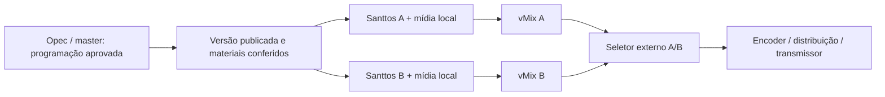

# Operação em duas cadeias Santtos + vMix

Estudo de 27/10/2026. Requisito confirmado: haverá dois computadores com vMix. Ainda é necessário confirmar se cada um também executará o Santtos ou se haverá dois PCs adicionais de playout, e identificar a saída final da TV. Este documento é uma proposta de engenharia; a redundância ainda não está implementada.

O operador informou 32 horas de operação sem falhas. É um resultado útil da instalação atual, mas não mede a continuidade de duas cadeias nem os tempos de comutação.

## Recomendação

Usar duas cadeias completas, ambas reproduzindo, com materiais locais e destinos distintos. Começar com seleção manual do sinal final; automatizar a seleção somente após testar as falhas de ponta a ponta.

O seletor pode ser um equipamento físico ou um receptor/serviço que aceite duas entradas IP. A escolha depende de como o sinal sai da TV. Colocar o seletor dentro do vMix A não protege contra a perda do computador A.

| Distribuição | Vantagem | Limite que exige teste |
|---|---|---|
| Dois PCs, cada um com Santtos e vMix | Menos equipamentos; cada PC é uma cadeia completa | CPU/GPU, disco e memória disputados; uma falha derruba os dois aplicativos daquela cadeia |
| Dois PCs Santtos + dois PCs vMix | Isola decodificação/playout da composição/encode | Mais interfaces, cabos, manutenção e pontos a monitorar |

Não é necessário contratar armazenamento em nuvem para isso. O servidor T: continua como origem e cada Santtos mantém sua cópia local dos materiais que precisa executar. O cache atual é uma base para essa função, mas precisa ganhar reserva de espaço e proteção contra remoção dos arquivos da janela operacional antes de servir como garantia de contingência.

## O que deve ser replicado

1. **Programação publicada:** data absoluta, versão, ordem, identificadores de ocorrência, IN/OUT, entradas ao vivo, horários, logo, GC e configurações de saída relevantes.
2. **Materiais por conteúdo:** tamanho e hash SHA-256 já medido na análise, com caminho local próprio por máquina. O mesmo nome ou a mesma letra T: não prova que os arquivos são iguais.
3. **Comandos do master:** seleção de ocorrência, posição de entrada, play/pause, avanço, FREEZE e alterações de grafismo. Cada comando precisa de identificador, sequência e confirmação para impedir repetição de um avanço após reconectar.
4. **Estado necessário do vMix:** preset, referências lógicas das entradas e comandos de operação. Os GUIDs do vMix devem ser mapeados por instalação; não presumir que sejam iguais nos dois PCs.

Não compartilhar o arquivo JSON em uso, o arquivo de checkpoint ou uma pasta gravável de banco entre processos. Cada máquina deve ter banco local, receber uma versão completa, validar sua disponibilidade e confirmar sua preparação antes de ativar. O novo mecanismo de gravação da playlist antes da ativação ajuda nessa etapa, mas não constitui replicação.

## Reprodução e sincronismo

Cada Santtos deve manter seu motor A/B e seu relógio de áudio/vídeo locais. A máquina B não deve depender da captura de tela, do monitor do operador nem da saída de áudio da máquina A.

Para arquivos, ambos recebem a mesma ocorrência e um instante de execução futuro, reconhecem a preparação e iniciam segundo a referência combinada. Comparar periodicamente ocorrência, posição, geração e versão da programação. Sincronizar os relógios de sistema com uma fonte de tempo confiável, preservando o relógio monotônico interno de cada motor.

Se houver diferença, corrigir a máquina fora do ar por uma nova preparação e entrada em posição segura. Não corrigir o áudio da máquina no ar isoladamente nem alterar continuamente sua velocidade para perseguir a outra.

Isso prepara uma comutação próxima do mesmo ponto do conteúdo; **não garante uma troca sem repetição/perda de quadro ou de amostra**. Alinhamento de relógio de sistema, alinhamento do conteúdo e alinhamento das saídas são problemas diferentes. Uma troca realmente contínua exige validar também receptores, latência, clock das saídas e o seletor.

Inputs Web demandam tratamento separado: dois acessos HLS podem receber segmentos diferentes ou ter atrasos diferentes; links assinados podem expirar; a plataforma pode limitar conexões simultâneas. Não usar o relógio do PC como prova de que os dois sinais ao vivo mostram o mesmo instante.

## Quem manda e quem seleciona o sinal

Deve haver um único master autorizado a editar/publicar e uma única autoridade para selecionar a saída final. As duas cadeias podem reproduzir e enviar sinais continuamente; seus endpoints devem ser diferentes. Não conectar dois RTMP à mesma chave esperando que o servidor resolva a redundância, nem usar nomes NDI/OMT indistinguíveis.

Na primeira etapa, o operador faz a comutação. Na etapa automática, a autoridade deve ficar fora das duas máquinas protegidas ou usar um mecanismo de arbitragem externo. Se apenas A e B decidirem pela ausência de resposta da outra, uma queda do cabo pode fazer ambas se considerarem principais.

Um árbitro externo pode emitir autorização com prazo e geração; comandos antigos são recusados. Isso não exige adotar etcd no produto. A documentação de quórum do etcd é uma referência útil para entender por que dois nós isolados não conseguem resolver sozinhos todas as partições de rede. Sem árbitro disponível, a política inicial recomendada é manter a saída já selecionada e permitir intervenção manual, em vez de alternar por suposição.

## Monitorar o que chega à TV

Monitorar em camadas:

- **Santtos:** progresso real do decoder, continuidade dos quadros e amostras, fila, versão da programação, preparo do próximo material e cache disponível.
- **Transporte:** conexão e recepção de mídia, contadores e atrasos de NDI/OMT/SRT; conexão aberta não prova vídeo em movimento.
- **vMix:** estado consultável pela API e entrada ativa esperada. API respondendo não prova que o encode da saída está saudável.
- **Depois do vMix:** presença e continuidade do sinal final e áudio. Um logo estático ou silêncio editorial não devem provocar comutação por si sós.

Antes de trocar, confirmar que B está disponível, com a versão correta e recebendo/reproduzindo material utilizável. Se o mesmo arquivo estiver corrompido nas duas máquinas, trocar A por B não resolve: aplica-se a contingência de conteúdo.

Depois de uma falha, não voltar automaticamente para A assim que ela reaparecer. Recuperar, conferir e ressincronizar A fora do ar, aguardar estabilidade e devolver o controle ao operador. Isso evita oscilações entre os sinais.

## vMix e sinal final

A API HTTP oficial permite consultar estado em XML e executar funções por entrada. Isso viabiliza supervisão e comandos coordenados, mas não é um mecanismo completo de replicação da sessão nem garantia de sincronismo entre dois vMix.

Configurar e conferir a saída correta: o Output 1 é o PROGRAM principal e é a origem padrão de streaming e gravação. A disponibilidade de saídas adicionais depende da edição do vMix. Os dois presets devem corresponder em resolução, FPS, buses de áudio e grafismos necessários.

Se a seleção final for SRT, usar duas entradas identificáveis e testar latência de recepção, reconexão e o corte entre elas. O vMix documenta Caller, Listener e Rendezvous e recomenda ajustar a latência às condições da rede. SRT transporta o sinal; não escolhe sozinho qual cadeia editorial deve estar no ar.

Se a seleção for SDI/HDMI, será necessário definir placas, formatos, sincronização e equipamento de comutação. Isso pertence à homologação da saída física; não pressupor suporte universal a placas na Lite.

## Relatórios

Separar o registro de execução de cada Santtos do registro do sinal efetivamente escolhido para ir ao ar. A e B reproduzindo o mesmo comercial não significam duas exibições.

O seletor deve registrar qual cadeia estava selecionada, instante, motivo e operador/decisão automática. Esse histórico será combinado com os relatórios por ocorrência. A versão inicial não deve somar os relatórios das duas máquinas nem apagar os erros da máquina fora do ar.

## Implantação e critérios de aceitação

| Etapa | Entrega verificável |
|---|---|
| 1. Preparação | Topologia e destino final definidos; instalação e perfis idênticos; nomes e endpoints A/B distintos; tempo de referência conferido |
| 2. Réplica | Programação versionada e materiais locais conferidos por hash; B executa sem o servidor T:; cache da janela operacional protegido |
| 3. Operação paralela | Comandos confirmados e deduplicados; comparação de ocorrência/posição; operação dos dois vMix verificada |
| 4. Comutação manual | Cortar o sinal final durante a perda de qualquer PC, medir interrupção/repetição/sincronismo e registrar a cadeia selecionada |
| 5. Automação | Árbitro e política aprovados; testar partição de rede, perda do árbitro, falhas simultâneas e retorno sem alternância indevida |

Os objetivos de tempo de recuperação e diferença máxima de posição precisam ser acordados após conhecer o seletor e a saída final. Não anunciar comutação instantânea sem medição no caminho real da TV.

Testar: desligamento do PC; encerramento do Santtos; decoder preso; vMix encerrado ou travado com API ainda respondendo; desconexão do T:; queda do switch; perda apenas do link entre A e B; reinício do árbitro; relógio desajustado; cache cheio; arquivo diferente com o mesmo nome; link Web vencido; retorno de A durante operação normal de B. Repetir próximo à troca de item, à meia-noite e durante aplicação de uma nova programação.

## Fontes consultadas

Consultadas em 27/10/2026:

- [vMix 29 — HTTP WEB API](https://www.vmix.com/help29/DeveloperAPI.html): funções por HTTP, referência das entradas e consulta de estado em XML.
- [vMix 29 — Outputs / NDI / OMT / SRT](https://www.vmix.com/help29/SettingsOutputs.html): função do Output 1, fontes de saída e diferenças por edição.
- [vMix 29 — SRT](https://www.vmix.com/help29/SRT.html): modos de conexão, requisitos e configuração de latência.
- [etcd — Failure modes](https://etcd.io/docs/v3.6/op-guide/failures/): falhas de líder, maioria e partições de rede. Referência conceitual; não é uma dependência proposta para a Lite.

As recomendações de topologia, replicação e comutação acima são decisões propostas para o Santtos a partir desses limites e da arquitetura atual. A consulta das fontes não substitui os testes dos equipamentos da instalação.
